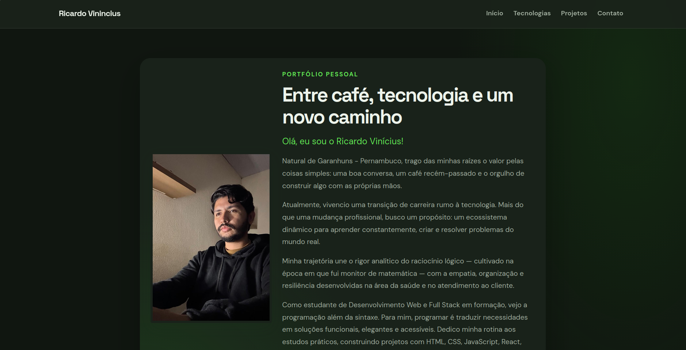

# Portfólio de Ricardo Vinícius

Portfólio pessoal criado para apresentar minha trajetória de transição para a tecnologia, as tecnologias que estou aprendendo e alguns dos meus projetos de desenvolvimento web e full stack.

## Sobre o projeto

O site reúne uma apresentação pessoal, uma seção de tecnologias, uma galeria de projetos com links para suas demonstrações e uma área de contato. A interface é responsiva e adapta o tema às preferências de aparência do dispositivo.



## Tecnologias

- React 19
- TypeScript
- Vite
- Bootstrap 5
- CSS
- Ionicons

## Projetos em destaque

- Quiz Interativo
- Landing Page de Cafeteria
- Página de Login Simples
- Página de Login 2.0
- Página de Links
- Landing Page Amanda
- Landing Page de Bebidas
- Loja de Eletrônicos
- Landing Page Fanta

Cada projeto tem uma imagem de apresentação e um link para sua demonstração.

## Executar localmente

É necessário ter Node.js e npm instalados.

1. Clone este repositório e entre na pasta do projeto.
2. Instale as dependências:

   ```bash
   npm install
   ```

3. Inicie o servidor de desenvolvimento:

   ```bash
   npm run dev
   ```

   Abra no navegador o endereço informado pelo Vite.

## Comandos disponíveis

| Comando | Descrição |
| --- | --- |
| `npm run dev` | Inicia o servidor de desenvolvimento com atualização automática. |
| `npm run build` | Verifica os tipos TypeScript e gera a versão de produção em `dist/`. |
| `npm run preview` | Inicia um servidor local para visualizar a versão de produção. |
| `npm run lint` | Executa o ESLint para verificar o código. |

## Estrutura principal

```text
src/
├── assets/
│   ├── foto-perfil/
│   └── imagens-projetos/
├── App.tsx
├── App.css
└── index.css
```

As imagens dos projetos ficam em `src/assets/imagens-projetos/` e a foto de perfil em `src/assets/foto-perfil/`.

## Contato

- [GitHub](https://github.com/Ricardo-Viniicius)
- [LinkedIn](https://www.linkedin.com/in/ricardo-viniicius/)
- [Instagram](https://www.instagram.com/ricardo__capito)
- E-mail: [capitoneeves@gmail.com](mailto:capitoneeves@gmail.com)
